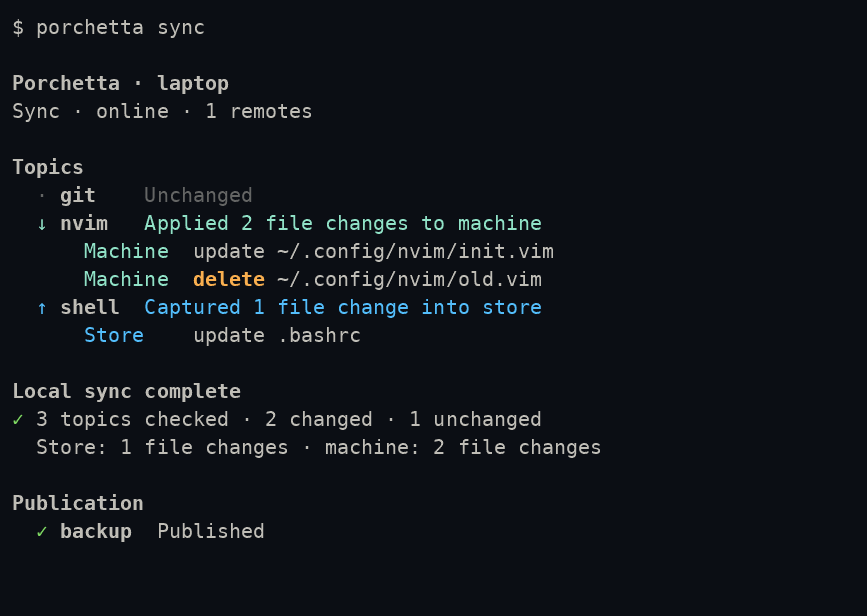

# Porchetta

Edit your dotfiles where you use them, then run `porchetta sync` to save your edits
and bring in changes from your other machines. Porchetta stores configs in Git,
merges changes, and asks you to resolve conflicts when needed.



## Install

With [Rust](https://rustup.rs/) and Git installed:

```sh
cargo install --locked --git https://github.com/PurpleMyst/porchetta.git
```

## Start with your existing configs

On the machine whose configs you want to keep, set `EDITOR` to your editor command
if it isn't already configured (`export EDITOR=nvim` in Bash, or
`$env:EDITOR = 'notepad.exe'` in PowerShell). Then create a store and open its manifest:

```sh
porchetta init
porchetta manifest edit
```

The manifest tells Porchetta which files to manage. Replace its contents with the
example below, keeping the entries for tools you use.

```lua
return {
    topics = {
        git = { paths = { ".gitconfig" } },
        shell = { paths = { ".bashrc" } },
        nvim = {
            root = ".config/nvim",
            paths = { "init.lua", "lua" },
        },
    },
}
```

Each named group is a **topic**. Paths start at your home directory; `root` gives
a topic a different base directory. This example covers Git, Bash and Neovim.
For Neovim on Windows or a mixed-platform setup, use the
[platform-dependent manifest example](docs/reference.md#platform-dependent-paths).
Adjust the entries to match files you already have, then save and close the editor.

Preview the files to capture, then save them to the local store:

```sh
porchetta sync --dry-run
porchetta sync
```

The report shows which files were captured into the store and which were applied
to your machine. Your store is at `~/.porchetta`.

## Share configs with another machine

Create an empty Git repository on your Git host, then replace the example URL
with its SSH or HTTPS URL:

```sh
porchetta remote add origin git@github.com:you/dotfiles.git
porchetta sync
```

That sync publishes your manifest and topics. Keep passwords and tokens out of
managed files, and use a private repository for personal configuration.

On the **second machine**, install Porchetta, set `EDITOR`, and clone the store:

```sh
porchetta clone git@github.com:you/dotfiles.git
porchetta sync --dry-run
porchetta sync
```

Start with `clone` rather than `init` on this machine. The preview shows what will
be applied and any local differences to merge. A normal sync walks you through
conflicts before applying the merged files.

## Day-to-day use

Edit your config files as usual. On the machine with your edits:

```sh
porchetta sync
```

Run the same command on your other machines to receive those changes. Each sync
also captures local edits and publishes the merged result to your configured remotes.

To work on just one topic, use its name from the manifest:

```sh
porchetta sync --dry-run --topic shell
porchetta sync --topic shell
```

Repeat `--topic` to select several topics. To save local changes while offline:

```sh
porchetta sync --offline
```

Run `porchetta sync` when you're back online to publish them.

## Resolve conflicts and retry failures

When both sides changed a file, Porchetta merges the edits. If they conflict,
`porchetta sync` opens the merged file in your editor. Resolve the conflict markers,
save, and close the editor to continue. For file/directory or symlink conflicts,
follow the prompt to choose what to keep. If you stop a sync to adjust files,
run `porchetta sync` again when you're ready.

- **Fetch failed:** restore access to the remote and retry. Use `sync --offline`
  to keep working locally.
- **Publication failed after local sync:** your local changes are saved. Fix the
  remote connection or permissions, then run `porchetta sync` again to publish.

## Find your next action

| Task | Command or guide |
|------|------------------|
| Change which files are managed | `porchetta manifest edit` |
| Check a topic's configured paths | `porchetta manifest inspect --topic shell` |
| Find the local store | `porchetta store path` |
| Check publication targets | `porchetta remote list` |
| Import a chezmoi setup | [Migration guide](docs/reference.md#migrate-from-chezmoi) |
| Add filters, transforms or symlinks | [Manifest reference](docs/reference.md#manifest) |
| Understand merges, previews and storage | [Sync reference](docs/reference.md#synchronization) |

Use `porchetta --help` for commands and `porchetta <command> --help` for options
and examples. For scripted manifest changes and revision checks, see
`porchetta manifest --help`.
