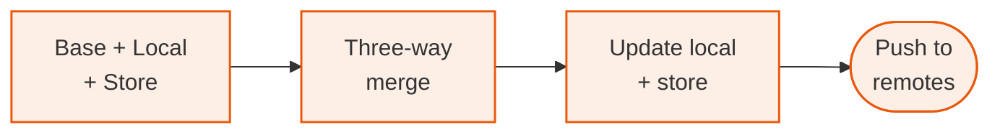

<div align="center">


# Porchetta

**Edit your dotfiles where they live. Sync them everywhere with Git.**<br>
Three-way merges, Lua manifests, and a bare Git store — no symlinks required to start.

<a href="#-install"></a>


<a href="LICENSE"></a>

[**Install**](#-install) · [Quick start](#-quick-start) · [Features](#-features) · [How it works](#-how-it-works) · [Reference](#-reference) · [Docs](docs/reference.md)

<br>



</div>

##  Why Porchetta

<table>
<tr>
<td width="25%" valign="top"><b>Edit in place</b><br>Keep configs at <code>~/.bashrc</code> or <code>~/.config/nvim</code> without managing a symlink farm.</td>
<td width="25%" valign="top"><b>Three-way merge</b><br>Merges local edits and remote commits instead of overwriting either side.</td>
<td width="25%" valign="top"><b>Lua per machine</b><br>Enable topics, swap paths, or transform files by OS, hostname, or env var.</td>
<td width="25%" valign="top"><b>Bare Git store</b><br>Lives in <code>~/.porchetta</code> with separate branches per topic and machine.</td>
</tr>
</table>

##  Install

Requires [Rust](https://rustup.rs/) and Git:

```sh
cargo install --locked --git https://github.com/PurpleMyst/porchetta.git
```

This installs the `porchetta` binary into `~/.cargo/bin`.

<details>
<summary><b>Build from a local checkout</b></summary>

<br>

```sh
git clone https://github.com/PurpleMyst/porchetta.git
cd porchetta
cargo install --locked --path .
```

</details>

##  Quick start

1. Initialize the local store and open the manifest in your editor[^editor]:

   ```sh
   porchetta init
   porchetta manifest edit
   ```

2. Declare the **topics** you want to manage in `manifest.lua`:

   ```lua
   return {
       topics = {
           git = { paths = { ".gitconfig" } },
           shell = { paths = { ".bashrc" } },
           nvim = {
               root = ".config/nvim",
               paths = { "init.lua", "lua" },
           },
       },
   }
   ```

3. Preview what will be captured, then run your first sync:

   ```sh
   porchetta sync --dry-run
   porchetta sync
   ```

4. Add an empty Git remote and publish your store:

   ```sh
   porchetta remote add origin git@github.com:you/dotfiles.git
   porchetta sync
   ```

5. On a second machine, clone the store instead of running `init`, then sync:

   ```sh
   porchetta clone git@github.com:you/dotfiles.git
   porchetta sync --dry-run
   porchetta sync
   ```

> [!IMPORTANT]
> Keep passwords, API tokens, and private keys out of managed files, and use a private repository for personal configs.

<details>
<summary><b>Migrating an existing chezmoi setup</b></summary>

<br>

Import topics and paths from `~/.local/share/chezmoi`, review the generated manifest, and sync:

```sh
porchetta init
porchetta migrate chezmoi
porchetta manifest edit
porchetta sync --dry-run
porchetta sync
```

Pass `--source-dir DIR` for a custom source path or `--yes` to skip the overwrite prompt.

</details>

[^editor]: Porchetta checks `$EDITOR`, `$VISUAL`, and then `nvim`, `nano`, `vim`, `vi`.

##  Features

### Topic filtering and offline sync

Sync everything with `porchetta sync`, limit work to specific topics, or commit locally while offline:

```sh
porchetta sync --dry-run --topic shell
porchetta sync --topic shell --topic git
porchetta sync --offline
```

<details>
<summary><b>Sample terminal output</b></summary>

<br>

<kbd></kbd>

</details>

### Per-machine Lua manifests

Porchetta evaluates `manifest.lua` on every machine, so a single manifest can adapt roots and enable topics by OS or `porchetta.hostname()`:

```lua
local windows = package.config:sub(1, 1) == "\\"
local nvim_root = windows
    and (os.getenv("LOCALAPPDATA") .. "/nvim")
    or ".config/nvim"

return {
    topics = {
        nvim = { root = nvim_root, paths = { "init.lua", "lua" } },
        shell = { enabled = not windows, paths = { ".bashrc" } },
    },
}
```

### Filters and content transforms

Exclude generated files with `should_include` and strip machine-specific fields on capture with `to_repo` and `porchetta.json`:

```lua
return {
    topics = {
        vscode = {
            root = ".config/Code/User",
            paths = { "settings.json" },
            to_repo = function(_, content)
                local cfg = porchetta.json.decode(content)
                cfg["telemetry.machineId"] = nil
                return porchetta.json.encode_pretty(cfg)
            end,
        },
    },
    should_include = function(path)
        return not ("/" .. path .. "/"):find("/node_modules/", 1, true)
    end,
}
```

<details>
<summary><b>Two-way transforms (<code>to_system</code>), <code>porchetta.system</code>, and <code>json.null</code></b></summary>

<br>

- **Swap placeholders in both directions** by pairing `to_repo` (store format) with `to_system` (local file format), e.g. replacing `$HOME` with `__HOME__`:

  ```lua
  local home = os.getenv("HOME")
  to_repo = function(_, content)
      return (content:gsub(home:gsub("(%W)", "%%%1"), "__HOME__"))
  end,
  to_system = function(_, content)
      return (content:gsub("__HOME__", home))
  end,
  ```

- **Run external formatters or generators** with `porchetta.system(args, stdin)`:

  ```lua
  to_repo = function(_, content)
      return porchetta.system({ "stylua", "-" }, content)
  end,
  ```

- **Preserve explicit JSON `null`:** `porchetta.json.decode` maps JSON `null` to `porchetta.json.null` (missing keys are Lua `nil`) and keeps empty `[]` / `{}` shapes intact on re-encode.

</details>

<details>
<summary><b>Editor completions with LuaLS</b></summary>

<br>

`porchetta manifest edit` launches your editor inside a temporary workspace preconfigured with `.luarc.json` and Porchetta's runtime stubs.

When editing a manifest outside `porchetta manifest edit`, point LuaLS at [src/luals/porchetta.lua](src/luals/porchetta.lua):

```json
{
  "runtime": { "version": "Lua 5.4" },
  "workspace": {
    "library": ["/path/to/porchetta/src/luals"],
    "checkThirdParty": false
  }
}
```

</details>

### Cross-topic symlinks

Declare symlinks whose targets resolve relative to another topic's `root` on the current machine:

```lua
return {
    topics = {
        shell = { root = ".config/shell", paths = { "common.sh" } },
        bash = {
            paths = { ".bashrc" },
            symlinks = {
                [".shell-common.sh"] = porchetta.topic("shell") / "common.sh",
                [".shell-config"] = porchetta.topics.shell,
            },
        },
    },
}
```

### Scriptable and agent-safe manifest CLI

Inspect evaluated config or update `manifest.lua` non-interactively with optimistic revision locking (`--if-revision`) and structured `--json` output:

```sh
porchetta manifest view --json
porchetta manifest validate --file manifest.lua --json
porchetta manifest set --file manifest.lua --if-revision <SHA256> --json
porchetta manifest inspect --topic shell --json
```

##  How it works



- **Three-way merge per topic:** Porchetta merges your current local files (`ours`) and the reconciled `topic/<name>` branch (`theirs`) against `system/<hostname>/<name>` (`base`), the last state synced on this machine.
- **Bare Git store:** Everything lives in `~/.porchetta` (`porchetta store path`). `manifest` and `topic/*` branches sync with remotes; `system/*` bookkeeping branches stay local.
- **Symmetric remotes:** Online syncs fetch every configured remote before merging and push to every configured remote after local sync succeeds.

##  Reference

| Command | Does |
|---|---|
| `porchetta init` | Create a new bare store at `~/.porchetta`. |
| `porchetta clone <url>` | Clone an existing store and set `origin`. |
| `porchetta sync [--dry-run] [--offline] [-t NAME]` | Capture local edits, merge, apply, and publish. |
| `porchetta manifest <edit\|view\|set\|validate\|inspect>` | Manage and inspect `manifest.lua`. |
| `porchetta remote <add\|list\|remove>` | Configure symmetric Git remotes. |
| `porchetta store path` | Print the store directory path. |
| `porchetta migrate chezmoi` | Import topics from a chezmoi source directory. |

For every topic in `manifest.lua`, Porchetta supports these fields:

| Field | Meaning | Default |
|---|---|---|
| `enabled` | Capture and apply this topic on this machine | `true` |
| `root` | Base directory relative to `$HOME` | `$HOME` |
| `paths` | Files or directories relative to `root` (`"."` for all) | — |
| `symlinks` | Map of link path to relative target or `porchetta.topic` | — |
| `should_include(path)` | Return `false` to skip a file or directory | `true` |
| `to_repo(path, content)` | Transform file content before storing | identity |
| `to_system(path, content, current)` | Transform incoming content before writing. Use `current` to [keep settings local](docs/reference.md#keep-settings-local-to-each-machine). | identity |

See [docs/reference.md](docs/reference.md) for merge semantics, line-ending normalization, and Lua helpers, or run `porchetta --help` and `porchetta manifest --help`.

##  Troubleshooting

<details>
<summary><b>Sync pauses with a conflict</b></summary>

<br>

- **File content conflict:** `porchetta sync` opens the merged file with conflict markers in your editor. Edit, save, and close the editor to continue.
- **Tree or symlink conflict:** Choose local, remote, or abort at the interactive prompt.

If you abort to inspect files manually, re-run `porchetta sync` when ready.

</details>

<details>
<summary><b>Fetch fails or you are without network access</b></summary>

<br>

Check configured remotes:

```sh
porchetta remote list
```

Sync locally without touching remotes, then run `porchetta sync` once back online:

```sh
porchetta sync --offline
```

</details>

<details>
<summary><b>Publication fails after local sync completes</b></summary>

<br>

Your local edits and store commits are already saved. Fix the remote credentials or connectivity, then re-run:

```sh
porchetta sync
```

</details>

<details>
<summary><b>Porchetta cannot find an editor</b></summary>

<br>

Verify `EDITOR` or `VISUAL` is set, or install one of `nvim`, `nano`, `vim`, or `vi`:

```sh
export EDITOR=nvim
```

</details>

##  Contributing

Before committing changes, run:

```sh
cargo clippy
cargo fmt --check
cargo test
```

##  License

[Apache-2.0](LICENSE)
